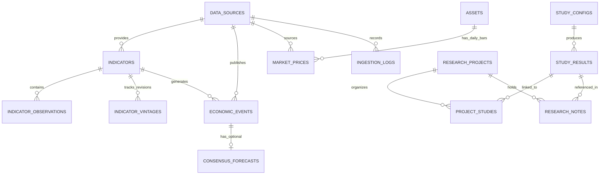

# MacroPulse
### Macroeconomic Event Impact & Market Sentiment Research Platform

[](https://github.com/macropulse/macropulse/actions)
[](https://www.python.org/)
[](https://react.dev/)
[](https://www.typescriptlang.org/)
[](https://fastapi.tiangolo.com/)

---

## 1. Scope & Research Objective

> **Scope Statement:** MacroPulse is a *daily-frequency* quantitative event-study platform. It measures closing-session to closing-session market reactions around macroeconomic releases. It does not measure intraday, minute-level, or tick-level price formation unless timestamped high-frequency order book data is added.

MacroPulse allows quantitative researchers, portfolio managers, and student quant applicants to reproducibly answer:
- How the S&P 500 (SPY), Treasuries (TLT, DGS2, DGS10), and commodities react around CPI, NFP, GDP, and FOMC announcements.
- Whether observed post-announcement abnormal returns are statistically distinguishable from zero or merely random walk variance.
- How market reactions vary across market volatility regimes (High Volatility vs. Low Volatility).
- Whether positive surprises produce asymmetric reactions relative to negative releases.
- How cross-asset correlations shift on event days compared to non-announcement days.

---

## 2. System Architecture

```mermaid
flowchart TD
    subgraph Data Sources
        FRED["St. Louis Fed FRED & ALFRED<br/>(Observations & First-Release Vintages)"]
        FOMC["Curated FOMC Registry<br/>(14:00 ET Statement Calendar)"]
        YF["Yahoo Finance / yfinance<br/>(Daily Adjusted Bars)"]
        DEMO["Bundled Verified Demo Fixtures<br/>(Zero-Config Offline Fallback)"]
    end

    subgraph Ingestion & Pipeline
        PIPE["Ingestion Pipeline & CLI<br/>(Idempotent Upserts, Tenacity Backoff, Audit Logs)"]
    end

    subgraph Storage [Database Engine]
        DB[("PostgreSQL 16 / SQLite<br/>(SQLAlchemy 2.x Typed ORM + Alembic)")]
    end

    subgraph Core Analytics Engine [Pure Functions - No I/O]
        ALIGN["NYSE Calendar Aligner<br/>(pandas_market_calendars, Day 0 Rules, Overlap Guard)"]
        MODELS["Expected-Return Models<br/>(Mean-Adjusted, Market-Adjusted, Market Model OLS)"]
        STUDY["Event Study Core<br/>(AR, CAR, AAR, CAAR, Standardized SAR)"]
        STATS["Inference & Diagnostics<br/>(Cross-Sectional t, BMP Test, Wilcoxon, Bootstrap CI)"]
        REGIMES["No Look-Ahead Regimes<br/>(Lagged 21d Realized Vol, 50/200 SMA, VIX)"]
    end

    subgraph API & Services
        FASTAPI["FastAPI REST Monolith<br/>(/event-studies, /surprises, /correlations, /regimes)"]
        REPORTS["ReportLab PDF & CSV Generator"]
    end

    subgraph Frontend SPA
        UI["React 18 + TypeScript (Strict)<br/>(Vite, TanStack Query v5, Plotly.js, Tailwind)"]
    end

    FRED --> PIPE
    FOMC --> PIPE
    YF --> PIPE
    DEMO --> PIPE
    PIPE --> DB
    DB --> FASTAPI
    FASTAPI --> Core Analytics Engine
    FASTAPI --> REPORTS
    UI <--> FASTAPI
```

---

## 3. Technology Stack

- **Frontend:** React 18, TypeScript (strict mode), Vite, Tailwind CSS (strict custom 6-token theme; default palette disabled), React Router v6, TanStack Query v5, Plotly.js (`react-plotly.js` + `plotly.js-dist-min`), Lucide React, React Hook Form + Zod, Vitest + Testing Library.
- **Backend:** Python 3.11+, FastAPI, Pydantic v2, SQLAlchemy 2.x (typed Declarative Base), Alembic, Pandas, NumPy, SciPy, Statsmodels, HTTPX (async + timeouts), `pandas_market_calendars` (NYSE calendar), `tenacity` (exponential retry/backoff), ReportLab (deterministic PDF generation), Pytest + pytest-asyncio.
- **Database:** PostgreSQL 16 in Docker/production; SQLite for zero-config local development.
- **Design System:** Strict financial palette:
  - `palladian` (`#EEE9DF`): Light background
  - `oatmeal` (`#C9C1B1`): Secondary surfaces, borders, muted
  - `blue-fantastic` (`#2C3B4D`): Navy nav, headers, dark cards
  - `burning-flame` (`#FFB162`): Primary accent, focus, active
  - `truffle` (`#A35139`): Secondary accent, negative/analytical emphasis
  - `abyssal` (`#1B2632`): Text, dark background, chart panels

---

## 4. Quantitative Event-Study Methodology & Formulas

### 4.1 Returns and Metric Distinction
- **Percentage Returns (Equities, ETFs, FX, Commodities):**
  $$R_t = \frac{P_t}{P_{t-1}} - 1 \quad \text{or} \quad r_t = \ln\left(\frac{P_t}{P_{t-1}}\right)$$
- **Yield Differences (Treasury Yields):**
  $$\Delta y_t = (y_t - y_{t-1}) \times 100 \quad \text{(basis points, bp)}$$
- **Index Differences (VIX):**
  $$\Delta VIX_t = VIX_t - VIX_{t-1} \quad \text{(index points)}$$
> **Non-Negotiable Rule:** Percentage returns and level changes are strictly segregated throughout the database schema, analytics engine, API, and charts. Basis point changes are never averaged with equity percentage returns.

### 4.2 Expected-Return Models
Estimated over the estimation window $[\tau_{est,start}, \tau_{est,end}]$ (default $[-260, -11]$, minimum 120 valid observations):

1. **Mean-Adjusted Model:**
   $$E[R_{i,t}] = \bar{R}_i = \frac{1}{T_{est}} \sum_{s \in est} R_{i,s}$$
2. **Market-Adjusted Model:**
   $$E[R_{i,t}] = R_{m,t} \quad \text{(Benchmark Return)}$$
3. **Market Model (Ordinary Least Squares):**
   $$R_{i,t} = \alpha_i + \beta_i R_{m,t} + \varepsilon_{i,t}$$
   $$\beta_i = \frac{\sum (R_{m,t} - \bar{R}_m)(R_{i,t} - \bar{R}_i)}{\sum (R_{m,t} - \bar{R}_m)^2}, \quad \alpha_i = \bar{R}_i - \beta_i \bar{R}_m$$
   $$\sigma_{\varepsilon,i} = \sqrt{\frac{1}{T_{est} - 2} \sum \varepsilon_{i,t}^2}$$

### 4.3 Abnormal Returns and Aggregation
- **Abnormal Return on Event Day $\tau$:**
  $$AR_{i,\tau} = R_{i,\tau} - E[R_{i,\tau}]$$
- **Cumulative Abnormal Return over Window $[\tau_1, \tau_2]$:**
  $$CAR_i(\tau_1, \tau_2) = \sum_{\tau=\tau_1}^{\tau_2} AR_{i,\tau}$$
- **Average Abnormal Return across $N$ Events:**
  $$AAR_\tau = \frac{1}{N} \sum_{i=1}^N AR_{i,\tau}, \quad SE(AAR_\tau) = \frac{\hat{\sigma}(AR_\tau)}{\sqrt{N}}$$
- **Cumulative Average Abnormal Return:**
  $$CAAR(\tau_1, \tau_2) = \sum_{\tau=\tau_1}^{\tau_2} AAR_\tau$$

### 4.4 Statistical Hypothesis Testing
1. **Cross-Sectional t-Test:**
   $$t = \frac{\overline{CAR}}{\hat{\sigma}_{CAR} / \sqrt{N}} \sim t(N - 1)$$
   $$95\% \text{ CI} = \overline{CAR} \pm t_{0.975, N-1} \times \frac{\hat{\sigma}_{CAR}}{\sqrt{N}}$$
2. **Boehmer–Musumeci–Poulsen (BMP 1991) Standardized Cross-Sectional Test:**
   Robust to event-induced variance increases. Each abnormal return is scaled by its forecast standard error:
   $$SAR_{i,\tau} = \frac{AR_{i,\tau}}{\hat{\sigma}_{\varepsilon,i} \sqrt{1 + \frac{1}{T_{est}} + \frac{(R_{m,\tau} - \bar{R}_m)^2}{\sum_{s \in est}(R_{m,s} - \bar{R}_m)^2}}}$$
   $$SCAR_i = \frac{1}{\sqrt{L}} \sum_{\tau=\tau_1}^{\tau_2} SAR_{i,\tau}, \quad Z_{BMP} = \frac{\frac{1}{N}\sum SCAR_i}{\sqrt{\frac{1}{N(N-1)}\sum(SCAR_i - \overline{SCAR})^2}}$$
3. **Nonparametric Tests:**
   - **Sign Test:** Exact binomial test of $H_0: p = 0.5$ on positive vs. negative CARs.
   - **Wilcoxon Signed-Rank Test:** Tests whether the distribution of CARs is symmetrically centered around zero.
4. **Percentile Bootstrap Confidence Interval:**
   $B = 5,000$ resamples with fixed deterministic seed (stored with study result for 100% reproducibility).
5. **Effect Size (Cohen's d):**
   $$d = \frac{\overline{CAR}}{\hat{\sigma}_{CAR}}$$
   Qualitative thresholds: $|d| < 0.2$ (Negligible), $0.2 \le |d| < 0.5$ (Small), $0.5 \le |d| < 0.8$ (Moderate), $|d| \ge 0.8$ (Large).

---

## 5. Calendar Alignment Rules

Handled in `analytics/alignment.py` using `pandas_market_calendars` NYSE calendar:
- **Timestamp Conversion:** All release timestamps converted to `America/New_York`.
- **Pre-Open Release (e.g. CPI 08:30 ET):** Release is prior to 09:30 market open. Day 0 is that trading session ($Close_{t-1} \to Close_t$ captures the reaction).
- **Session Release (e.g. FOMC 14:00 ET):** Day 0 is that trading session, explicitly flagged with `intraday_release_daily_measure`.
- **After-Close Release ( $\ge$ 16:00 ET):** Day 0 is the subsequent trading session (e.g., Friday 16:30 ET aligns to Monday).
- **Holiday / Weekend Release:** Aligns to the first active trading day following the holiday.
- **Missing Observations:** Missing price records are never filled across holidays. Events lacking sufficient estimation or window observations are excluded with an audit reason.
- **Overlap Guard:** Detects whether adjacent windows of the same event type overlap.

---

## 6. Database Schema



---

## 7. Local Setup & Quickstart

### Option A: Local Zero-Config (SQLite)

1. **Clone the repository:**
   ```bash
   git clone https://github.com/macropulse/macropulse.git
   cd macropulse
   ```

2. **Backend Setup:**
   ```bash
   cd backend
   python -m venv venv
   source venv/bin/activate  # Or `venv\Scripts\activate` on Windows
   pip install -e ".[dev]"
   alembic upgrade head
   python -m macropulse.ingest all
   uvicorn macropulse.main:app --reload --port 8000
   ```

3. **Frontend Setup (in a separate terminal):**
   ```bash
   cd frontend
   npm install
   npm run dev
   ```
   Open `http://localhost:5173` in your browser.

### Option B: Docker Compose (PostgreSQL 16)

```bash
docker compose up --build
```
- Frontend UI: `http://localhost:3000`
- Backend API Docs: `http://localhost:8000/docs`
- PostgreSQL: `localhost:5432`

---

## 8. Verification & Running Tests

MacroPulse has an extensive test suite verifying mathematical formulas, OLS equations, statistical inference, calendar alignment, and zero look-ahead bias:

```bash
# Backend unit & integration tests
cd backend
pytest tests/ -v

# Frontend Vitest unit tests
cd frontend
npm test

# Production build check
npm run build
```

---

## 9. Limitations & Future Quant Work

1. **Daily Frequency:** Daily closing prices reflect all news between $16:00_{t-1}$ and $16:00_t$, not exclusively the macroeconomic announcement. Intraday 1-minute order book data is required to isolate high-frequency price impact.
2. **Revision Bias:** Macroeconomic figures are revised over subsequent months. MacroPulse avoids look-ahead by defaulting to first-release vintages from ALFRED, but real-time revisions can still introduce historical noise.
3. **Consensus Surprise vs. Indicator Change:** Free commercial historical analyst consensus (e.g., Bloomberg or Reuters surveys) is proprietary. MacroPulse runs in Indicator Change mode by default unless historical consensus CSVs are imported.
